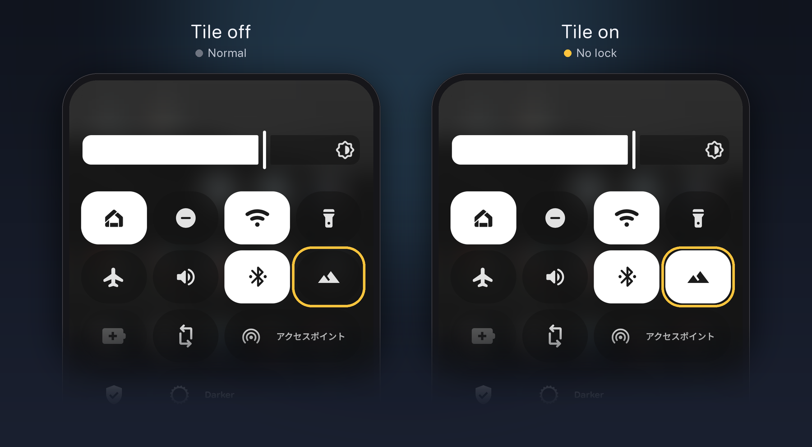

# tozan-mode

A Quick Settings tile for Android that keeps the phone unlocked while you are hiking. "Tozan" (登山) is Japanese for mountain climbing. Tap the tile at the trailhead, tap it again when you are back.

Your PIN, fingerprints and wallet cards stay untouched. The tile only changes a handful of system settings and puts them back afterwards.

<p align="center">
  
</p>

> [!NOTE]
> This is a personal project, written for my own phone. It has only been tested on a Pixel 9a running Android 17. Other devices and Android versions may behave differently, and I cannot test on hardware I do not own. Use it at your own risk.

## What it does

While the tile is on:

- The phone does not lock when the screen turns off. The delay between screen-off and lock (`lock_screen_lock_after_timeout`) is raised to 12 hours.
- Only the power button wakes the screen. Tap to check, double-tap to check, double-tap to wake, lift to check and the wake gesture are turned off, so the unlocked phone does not wake up in your pocket.

Turning the tile off restores every setting to the value it had when the tile was turned on. The previous values are read from the device, not hard-coded.

Turning the tile on from the lock screen asks for your PIN or fingerprint first.

## Requirements

- Android 10 (API 29) or later.
- A computer with `adb`, the Android SDK and JDK 17. The app is built from source and installed over `adb`. There is no prebuilt APK and it is not on the Play Store.

## Install

```sh
./gradlew assembleRelease
adb install -r app/build/outputs/apk/release/app-release.apk
adb shell pm grant com.ymmooot.tozanmode android.permission.WRITE_SECURE_SETTINGS
adb shell cmd statusbar add-tile com.ymmooot.tozanmode/.TozanTileService
```

`WRITE_SECURE_SETTINGS` is a system permission that cannot be granted from the device itself, which is why the `pm grant` step is needed. Without it the tile is greyed out. The permission survives reboots and reinstalls with `adb install -r`, but not an uninstall.

The last command adds the tile to Quick Settings. You can also add it by hand from the Quick Settings editor, where it appears as Tozan Mode (登山モード when the device language is Japanese).

The release build is signed with the debug key of the machine that built it. An APK built on another machine cannot be installed over it without uninstalling first.

The app has no launcher icon. It shows up only as a tile and under Settings → Apps.

## Uninstall

Turn the tile off first, then:

```sh
adb uninstall com.ymmooot.tozanmode
```

Uninstalling while the mode is on discards the saved values and leaves the phone in its hiking state.

## Things to know

- **Power button instantly locks.** If this option is enabled in the screen lock settings, pressing the power button still locks the phone immediately. Turn it off if you put the phone to sleep with the power button.
- **Reboot.** Android always asks for the PIN once after a restart.
- **No automatic turn-off.** The mode stays on until you tap the tile again.
- **Changes made while the mode is on are overwritten.** Turning the tile off writes back the values saved when it was turned on.
- **Security.** While the mode is on, anyone who picks up the phone can use it.
- **Other devices.** The wake settings are the ones a Pixel uses. Phones from other manufacturers may keep waking on tap or lift.

## Source

The whole app is one Kotlin file, [`TozanTileService.kt`](app/src/main/kotlin/com/ymmooot/tozanmode/TozanTileService.kt). It is short enough to read before granting it a system permission.

## License

[MIT](LICENSE)
